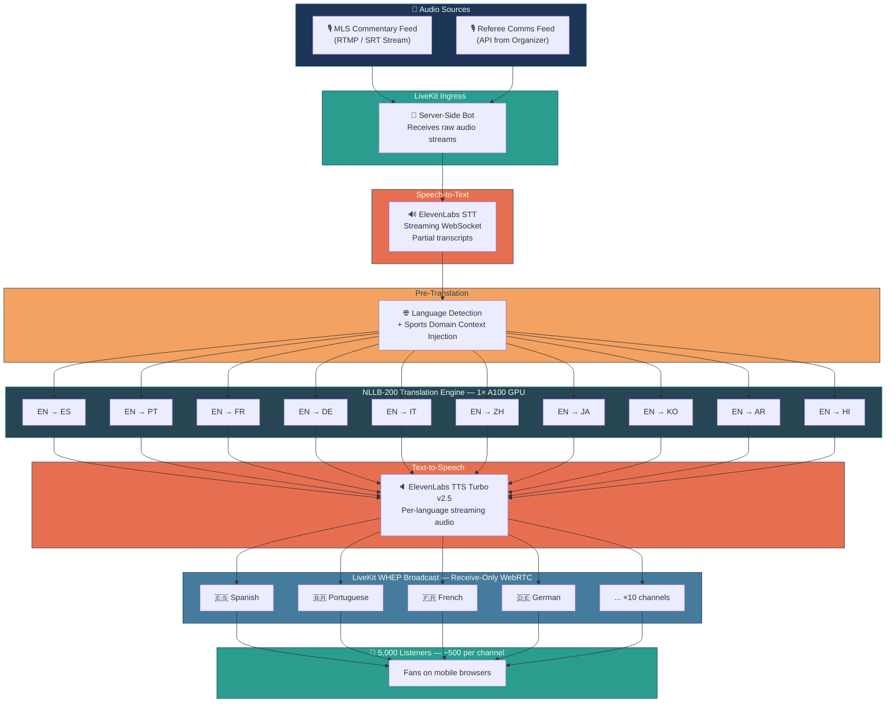
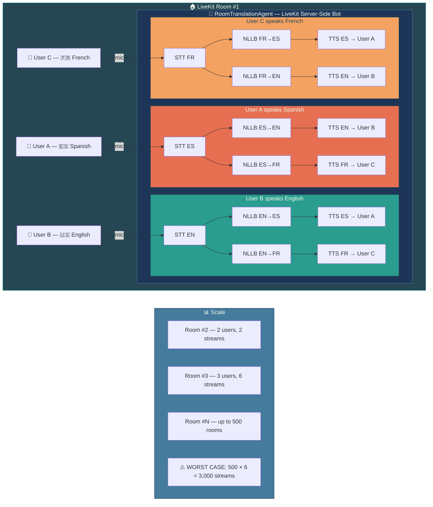
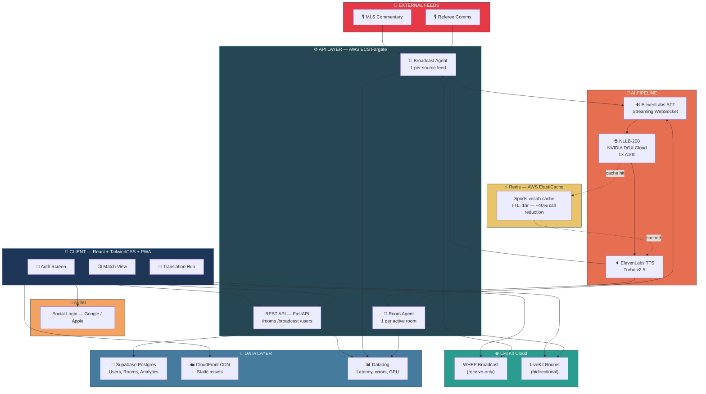
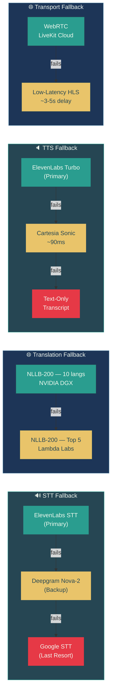
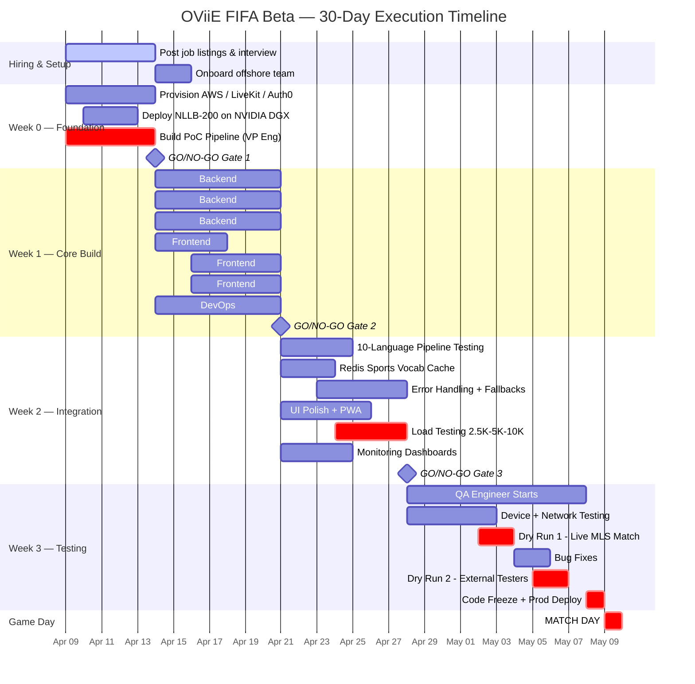

# OViiE AI — STELLA™ FIFA Beta Launch Execution Plan

**Inter Miami CF × MLS — Chase Stadium (25,000 Capacity)**
**Target: May 9, 2026 | Build Window: 21 Days + 7 Days Testing**
**Prepared: April 9, 2026 | INTERNAL — CONFIDENTIAL**

---

## Table of Contents

1. Executive Summary & Scope
2. Timeline — Key Milestones & Go/No-Go Gates
3. Team — Hiring Plan & Roles
4. System Architecture & Diagrams
5. Tech Stack — Final Decisions
6. Week-by-Week Sprint Plan
7. Cloud Credits & Budget
8. Risks & Mitigations
9. Inter Miami / MLS Requirements
10. Operational Runbook — Game Day
11. Immediate Action Items (Next 48 Hours)

---

## 1. Executive Summary & Scope

OViiE AI will beta-test STELLA™ at an Inter Miami CF MLS match on **May 9, 2026** at Chase Stadium (25,000 capacity) in Fort Lauderdale, FL. The platform delivers real-time AI-powered voice translation of match commentary and referee communications, plus fan-to-fan Translation Hub rooms, all accessible via a mobile-responsive web application.

### Product Features for Beta

- **Live Commentary Translation** — Official MLS broadcast commentary translated in real-time into 10 languages and streamed to fans. One-to-many broadcast architecture.
- **Referee Comms Translation** — Referee communications (if feed is provided by MLS/organizer) translated and streamed to fans. Same broadcast architecture.
- **Translation Hub** — Virtual voice rooms where 2–3 fans speaking different languages can converse in real-time with sub-1-second translation. Bidirectional, capped at 500 concurrent rooms.

### Scope Boundaries

| Category | IN Scope (Beta) | OUT of Scope (Post-Beta) |
|---|---|---|
| Languages | 10 languages | 90+ (ElevenLabs + NLLB capable) |
| Platform | Mobile web (PWA) | Native iOS / Android |
| Users | Cap at 5,000 beta users | Full 25K stadium |
| Translation Hub | 1:1 and up to 3 people | Larger group rooms |
| Commentary | Broadcast translation | Multiple commentary tracks |
| Referee | If feed available | Full referee integration |
| Analytics | Basic latency monitoring | Organizer dashboard |
| Offline | None | Cached phrase fallback |

### MVP vs Stretch

**MUST HAVE (ship or no-go):**
- User login (Auth0, social login)
- Language selection (10 languages)
- Live commentary translation (broadcast, listen-only)
- Translation Hub (1:1 voice rooms)
- Mobile-responsive web app (PWA)

**SHOULD HAVE (if time permits):**
- Translation Hub with 3 people
- Referee comms translation
- Text transcript alongside audio
- Match info dashboard (score, time)

**CUT for beta (do later):**
- Native iOS/Android app
- More than 10 languages
- More than 500 concurrent Translation Hub rooms
- Offline mode
- Analytics dashboard for organizers

---

## 2. Timeline — Key Milestones & Go/No-Go Gates

| Date | Milestone | Go/No-Go Gate |
|---|---|---|
| Apr 9–14 | WEEK 0: Hiring, infra setup, PoC pipeline | **GATE 1:** Pipeline achieves <1.5s E2E latency? |
| Apr 14–21 | WEEK 1: Core build — both systems E2E in dev | **GATE 2:** User can log in and hear translated audio? |
| Apr 21–28 | WEEK 2: Integration, polish, load testing | **GATE 3:** 5K users, <2s latency, 10 langs all working? |
| Apr 28–May 4 | WEEK 3: QA, dry run #1 with live MLS match | Dry run #1 (May 2–3) |
| May 5–7 | Final testing with 50–100 external testers | Dry run #2 (May 5–6) |
| May 8 | Code freeze. Deploy to production. | **FINAL GO/NO-GO** |
| **May 9** | **🏆 GAME DAY** | — |

### Gate Failure Fallbacks

- **Gate 1 fails** → Investigate latency bottleneck. Do NOT write product code until resolved.
- **Gate 2 fails** → Re-scope to Translation Hub only (drop commentary/referee).
- **Gate 3 fails** → Reduce user cap to 2,000 OR push to next home match.
- **Final gate fails** → Abort beta. Regroup for next available match.

---

## 3. Team — Hiring Plan & Roles

**Current team:** 1 engineer (VP of Engineering).
**Target:** 6 people total by April 14.
**Hiring channels:** Toptal, Lemon.io, direct LinkedIn outreach.
**Timezone requirement:** Overlap with US Eastern (Latin America or Eastern Europe).

| Role | Count | Rate (USD/hr) | Start Date | Key Skills Required |
|---|---|---|---|---|
| Sr. Backend / Real-time Engineer | 1 | $45–65 | Apr 14 | LiveKit, WebRTC, Python, streaming audio |
| Sr. Frontend Engineer (React) | 1 | $40–55 | Apr 14 | React, Vite, TailwindCSS, PWA |
| Mid Frontend Engineer | 1 | $25–40 | Apr 14 | React, responsive/mobile design, UI polish |
| DevOps / Infra Engineer | 1 (part-time OK) | $40–55 | Apr 14 | AWS ECS/Fargate, CI/CD, GPU deployment, monitoring |
| QA Engineer | 1 | $20–30 | Apr 28 | Mobile device testing, load testing, network simulation |

**Total team cost (3 weeks): $18,000 – $30,000**

### VP of Engineering Role During Build

- Architecture lead and all final technical decisions
- ElevenLabs + NLLB pipeline integration (owns the core AI pipeline)
- Inter Miami / MLS relationship and audio feed negotiations
- Go/no-go gate decisions at each milestone
- Hiring, onboarding, and daily standups with offshore team

---

## 4. System Architecture & Diagrams

The application consists of **two fundamentally different real-time systems**. They share authentication and the frontend shell but have completely distinct backend architectures.

### The Critical Insight

> **This is a broadcast translation problem, NOT a peer-to-peer translation problem.**
> You have a small number of source audio streams translated into 10 languages and fanned out to thousands of listeners. You only run 10 translation pipelines regardless of whether 100 or 25,000 people are listening. Scaling is in the **distribution layer**, not the translation layer.

---

### System A: Broadcast Translation (Commentary + Referee)

One-to-many broadcast. Source audio → translated into 10 languages → fanned out to all listeners.

> 📂 See: `diagram_1_broadcast_system.mermaid`

**Key Design Decision:** LiveKit WHEP allows **receive-only** WebRTC connections. Each listener is NOT a full bidirectional participant — they are lightweight subscribers. This is how you scale to 5,000+ listeners without 5,000 bidirectional streams. **Only 10 translation pipelines run, not 5,000.**

---

### System B: Translation Hub (Virtual Rooms)

Bidirectional, small-group voice translation. 2–3 people in a LiveKit room, each hearing others in their language.

> 📂 See: `diagram_2_translation_hub.mermaid`

---

### Full System Overview — Combined Architecture

> 📂 See: `diagram_3_full_architecture.mermaid`

---

### Data Flow — End-to-End Latency Pipeline

> 📂 See: `diagram_4_latency_pipeline.mermaid`

```mermaid
graph LR
    MIC["🎙️ Audio Capture<br/>~50ms"] --> NET1["🌐 Network<br/>~50ms"] --> STT_P["🔊 ElevenLabs STT<br/>~150-250ms"] --> NLLB_P["🌐 NLLB-200<br/>~50-100ms"] --> TTS_P["🔈 ElevenLabs TTS<br/>~150-250ms"] --> NET2["🌐 Delivery<br/>~50-100ms"] --> EAR["🔊 User Hears<br/>Translation"]

    style MIC fill:#2a9d8f,stroke:#264653,color:#f1faee
    style NET1 fill:#457b9d,stroke:#264653,color:#f1faee
    style STT_P fill:#e76f51,stroke:#264653,color:#f1faee
    style NLLB_P fill:#1d3557,stroke:#457b9d,color:#f1faee
    style TTS_P fill:#e76f51,stroke:#264653,color:#f1faee
    style NET2 fill:#457b9d,stroke:#264653,color:#f1faee
    style EAR fill:#2a9d8f,stroke:#264653,color:#f1faee
```

**Total: 450–800ms (p50 ~600ms, p95 ~900ms, p99 ~1200ms)**

---

### Fallback / Resilience Architecture

> 📂 See: `diagram_5_fallback_chain.mermaid`

---

### Project Timeline — Gantt Chart

> 📂 See: `diagram_6_timeline_gantt.mermaid`

---

## 5. Tech Stack — Final Decisions

| Layer | Technology | Rationale |
|---|---|---|
| Frontend | React (Vite) + TailwindCSS | Existing stack. Mobile-first, PWA-capable. |
| Real-time Audio | LiveKit Cloud (beta) → self-host later | Self-hosting 25K WebRTC in 3 weeks is not feasible. Use LiveKit Cloud. Apply for startup credits. |
| STT | ElevenLabs Speech-to-Text (streaming) | Already selected. WebSocket streaming for partial transcripts. |
| Translation | NLLB-200 (1.3B distilled) on GPU | Deploy on NVIDIA DGX Cloud ($350K credits). 1× A100 handles 10 lang pairs at <100ms. |
| TTS | ElevenLabs TTS (Turbo v2.5) | Already selected. Streaming output. Biggest API cost — budget carefully. |
| Auth | Auth0 (social login) | Already selected. Google/Apple login for frictionless stadium onboarding. |
| Database | Supabase (Postgres) | Already have it. User profiles, language prefs, room metadata. NOT audio. |
| Hosting | AWS (ECS Fargate) + CloudFront CDN | Use $6K+ AWS credits. Frontend on CloudFront. |
| Pipeline Server | LiveKit Agents (Python) | Server-side bots that join rooms, capture audio, run pipeline, publish translated audio back. |
| Caching | Redis (AWS ElastiCache) | Sports phrase cache ("goal", "foul", "offside"). Reduces model calls ~40%. |
| Monitoring | Datadog free tier | Latency tracking per pipeline stage. Non-negotiable for live event. |

### Latency Budget Breakdown

| Stage | Target Latency | Notes |
|---|---|---|
| Audio capture + network | 50–100ms | WebRTC built-in, varies by cellular |
| ElevenLabs STT | 150–250ms | Streaming partial transcripts |
| NLLB Translation | 50–100ms | GPU inference, batched |
| ElevenLabs TTS | 150–250ms | Turbo v2.5 streaming |
| Audio delivery + playback | 50–100ms | WebRTC / WHEP |
| **TOTAL** | **450–800ms** | **p50 < 600ms, p99 < 1200ms** |

---

## 6. Week-by-Week Sprint Plan

### WEEK 0: April 9–14 — Setup & Hiring

**Goal:** Team assembled, infra provisioned, PoC pipeline validated.

- [ ] Post job listings, interview, hire 4 offshore engineers
- [ ] Set up monorepo (Turborepo: `apps/web`, `packages/pipeline`, `packages/shared`)
- [ ] Provision AWS account (VPC, IAM, ECS cluster, CloudFront distribution)
- [ ] Deploy NLLB-200 distilled model on NVIDIA DGX Cloud — test inference latency
- [ ] Get LiveKit Cloud account — test basic room creation + audio publishing
- [ ] Set up Auth0 tenant with Google and Apple social logins
- [ ] Create Figma wireframes: Landing → Language Select → Match View → Translation Hub
- [ ] **YOU:** Build PoC pipeline (mic → ElevenLabs STT → NLLB → ElevenLabs TTS → speaker) — measure latency

> ⚠️ **GO/NO-GO #1 (April 14):** Can you achieve <1.5s end-to-end latency in the pipeline PoC? If NO → investigate bottleneck before writing any product code.

---

### WEEK 1: April 14–21 — Core Build

**Goal:** Both systems (Broadcast + Hub) working end-to-end in dev environment.

#### Backend (VP + Backend Engineer)
- [ ] LiveKit Agents: `BroadcastTranslationAgent` — joins room, captures audio, runs STT→NLLB→TTS, publishes per-language tracks
- [ ] LiveKit Agents: `RoomTranslationAgent` — bidirectional for Translation Hub rooms
- [ ] API endpoints: `POST /rooms` (create room), `GET /broadcast/languages` (available streams), `POST /rooms/:id/join`
- [ ] Audio ingress: mechanism to feed commentary/referee audio into LiveKit (RTMP, SRT, or file-based for testing)
- [ ] Language detection auto-fallback (if STT detects wrong language, re-route)

#### Frontend (2 Frontend Engineers)
- [ ] App shell: landing page, Auth0 login/signup flow, language selection (10 languages with flag icons)
- [ ] **Match View:** live audio player for commentary + referee channels. User picks language, subscribes to LiveKit track. LIVE indicator + translation status.
- [ ] **Translation Hub:** room browser, create/join room UI, in-room voice UI (push-to-talk or VAD), participant list with language badges
- [ ] Responsive mobile-first design (most fans will be on phones in the stadium)

#### DevOps
- [ ] CI/CD pipeline (GitHub Actions → AWS ECS)
- [ ] LiveKit Cloud project configuration
- [ ] NLLB model serving behind internal API (FastAPI on GPU instance)
- [ ] SSL, domain setup (`fifa-beta.oviie.com` or similar)

> ⚠️ **GO/NO-GO #2 (April 21):** Can a user log in, select Spanish, and hear a test English audio stream translated to Spanish in <1.5s? Can two users join a Translation Hub room and talk across languages?

---

### WEEK 2: April 21–28 — Integration & Scale Prep

**Goal:** Production-hardened, load-tested, all 10 languages working, UI polished.

#### Backend
- [ ] All 10 language pipelines tested and validated
- [ ] Redis translation cache — pre-translate common sports vocabulary ("goal", "foul", "offside", "penalty", "corner kick", "yellow card", "red card", "substitution", "halftime", "injury time")
- [ ] Error handling: ElevenLabs fallback (queue + retry), NLLB degradation (reduce to fewer languages)
- [ ] Rate limiting per user, room caps (500 concurrent rooms)
- [ ] Analytics event tracking: latency per pipeline stage, language distribution, room usage

#### Frontend
- [ ] UI polish: loading states, error toasts, auto-reconnection on network drop
- [ ] Match dashboard: live match info (score, time, events) alongside translation controls
- [ ] Text transcript view alongside audio (for noisy stadium, accessibility)
- [ ] PWA manifest + service worker (Add to Home Screen capability)
- [ ] 3-screen onboarding tutorial explaining the product to new users

#### DevOps
- [ ] Load testing: simulate 2,500 → 5,000 → 10,000 concurrent WebRTC listeners
- [ ] Auto-scaling rules for ECS tasks and LiveKit
- [ ] Monitoring dashboards (latency p50/p95/p99, error rates, concurrent users)
- [ ] Staging environment — full mirror of production

> ⚠️ **GO/NO-GO #3 (April 28):** Load test passes at 5,000 concurrent users with <2s latency? All 10 languages working? Translation Hub stable with 100 concurrent rooms?

---

### WEEK 3: April 28 – May 8 — Testing & Hardening

**Goal:** Battle-tested, zero known P0 bugs, ready for live event.

- [ ] **QA engineer starts:** systematic test plan across devices (iPhone Safari, Android Chrome, desktop Chrome/Firefox)
- [ ] Cellular network testing (throttle to 3G/4G, simulate high-density network conditions)
- [ ] **Dry Run #1 (May 2–3):** Internal team watches a live MLS match through the app end-to-end
- [ ] **Dry Run #2 (May 5–6):** Invite 50–100 external beta testers (friends, family, advisors)
- [ ] Fix all P0 and P1 bugs discovered in dry runs
- [ ] Write operational runbook: who monitors what during live match, escalation procedures, rollback plan
- [ ] **May 8:** Final go/no-go decision. Deploy to production. **CODE FREEZE.**
- [ ] **May 9:** 🏆 **GAME DAY** — all hands on deck

---

## 7. Cloud Credits & Budget

### Available Cloud Credits (NVIDIA Inception Program)

| Provider | Amount | Status | Use For |
|---|---|---|---|
| NVIDIA DGX Cloud | $350,000 | Confirmed | NLLB-200 GPU inference (PRIMARY) |
| AWS | $100,000+ | NVIDIA Confirmed — **CLAIM NOW** | ECS, CloudFront, ElastiCache, monitoring |
| AWS (existing) | $6,000 | Available | Immediate dev/staging infra |
| Lambda Labs | $7,000 | Available | Backup GPU / dev testing |
| Google Cloud | $350,000 | Confirmed | Reserve for future / backup |
| Nebius Cloud | $155,000 | Confirmed | Reserve for future GPU needs |
| Yotta Cloud | $50,000 | Confirmed | Reserve |

> ⚠️ **ACTION:** Contact NVIDIA Inception program manager TODAY to activate confirmed AWS credits and NVIDIA DGX Cloud credits. The $350K NVIDIA credits alone cover GPU inference for the entire beta program.

### Development Cost (3 Weeks)

| Item | Estimated Cost |
|---|---|
| 4 offshore engineers (3 weeks) | $18,000 – $30,000 |
| LiveKit Cloud (dev + testing) | ~$500 |
| ElevenLabs API (dev + testing) | ~$500 – $1,000 |
| AWS infra (dev) | ~$200 (covered by credits) |
| Domain, SSL, misc | ~$50 |
| **TOTAL DEVELOPMENT** | **$19,000 – $32,000** |

### Per-Match Cost (Game Day)

| Item | Estimated Cost | Notes |
|---|---|---|
| ElevenLabs TTS | $2,000 – $5,000 | 10 langs × 150 min broadcast + Hub usage. Negotiate enterprise deal. |
| ElevenLabs STT | $500 – $1,000 | Commentary + referee + hub rooms |
| LiveKit Cloud (5K concurrent) | $2,000 – $4,500 | Audio-only connections, ~150 min average session |
| NLLB GPU inference | $15 – $30 | 1× A100 for 3 hours. Covered by NVIDIA credits. |
| AWS infra | $100 – $200 | Covered by credits |
| **TOTAL PER MATCH** | **$4,600 – $10,700** | |

### Total Budget for CFO

**$24,000 – $43,000** (development + first match). Cloud infrastructure costs are largely covered by NVIDIA Inception credits.

---

## 8. Risks & Mitigations

| Risk | Impact | Likelihood | Mitigation |
|---|---|---|---|
| Cannot get audio feeds from MLS / Inter Miami in time | **CRITICAL** — kills commentary + referee features | Medium | Start conversation THIS WEEK. If not confirmed by Apr 21, descope to Translation Hub only. |
| ElevenLabs latency spikes under load | **HIGH** — >1s latency, poor UX | Medium | Deepgram STT as backup. Cartesia Sonic TTS (~90ms) as TTS fallback. |
| Stadium cellular network overloaded (25K phones) | **HIGH** — app unusable for many users | High | Cap beta at 5,000 users (first-come-first-served). Discuss dedicated WiFi/5G with stadium ops. |
| Cannot hire engineers fast enough | **HIGH** — miss sprint deadlines | Medium | Start hiring TODAY. Backup: engage a dev agency (Lemon.io team plan) for frontend. |
| LiveKit cannot handle 5K+ concurrent at acceptable latency | **MEDIUM** — broadcast feature fails | Low | Load test by Apr 28. Fallback: low-latency HLS (~3–5s latency) for broadcast, WebRTC only for Hub. |
| NLLB translation quality poor for some language pairs | **MEDIUM** — bad UX for specific languages | Medium | Test all 10 pairs in Week 2. Drop underperforming languages to maintain quality bar. |
| Auth0 or Supabase outage during match | **MEDIUM** — users can't log in or access rooms | Low | Pre-authenticate users (token TTL > match duration). Cache user preferences locally in PWA. |

---

## 9. Inter Miami / MLS Requirements

Begin outreach **IMMEDIATELY**. The audio feed is the #1 external dependency.

- **Commentary Audio Feed** — Real-time audio output from the official broadcast. Format: RTMP stream, SRT, or any low-latency protocol. This is the single most critical dependency.
- **Referee Comms API** — If MLS provides referee audio via an API or feed. If this does not exist, descope referee comms from the beta entirely. Do not let this block the launch.
- **Stadium WiFi / Network** — Request a dedicated SSID for the beta app, or at minimum, written confirmation of the cellular coverage quality at Chase Stadium. High-density cellular is the biggest UX risk.
- **Beta User Distribution Mechanism** — How will 5,000 fans get access? Options: QR code printed on tickets, announcement on stadium screens, email blast to season ticket holders, dedicated landing page promoted on social media.
- **Branding Approval** — Can the app display Inter Miami CF and MLS logos? What brand guidelines apply?
- **Technical Contact** — A single point of contact at Inter Miami or their broadcast partner who can provide the audio feed endpoint and troubleshoot on game day.

> ⚠️ **DEADLINE:** Audio feed must be confirmed by April 21 (Go/No-Go #2). If not confirmed, the beta launches with Translation Hub only — which is still a strong product demo.

---

## 10. Operational Runbook — Game Day (May 9)

### Pre-Match Checklist (T-4 hours)

- [ ] Deploy final production build and verify all services healthy
- [ ] Spin up NLLB GPU instance on NVIDIA DGX Cloud, warm up model with test translations
- [ ] Verify LiveKit Cloud capacity reservation for 5,000 concurrent connections
- [ ] Test commentary audio feed connection with MLS broadcast partner
- [ ] All team members join dedicated monitoring Slack channel
- [ ] Verify Datadog dashboards: latency, error rates, concurrent users, GPU utilization
- [ ] Test emergency kill switch (feature flags to disable features gracefully)
- [ ] Confirm Redis cache is pre-loaded with sports vocabulary translations

### During Match — Monitoring Assignments

| Person | Monitors | Escalation Trigger |
|---|---|---|
| VP of Engineering | Overall system health, user reports, business comms | Any P0 incident |
| Backend Engineer | Pipeline latency (per stage), NLLB GPU utilization, ElevenLabs API health | Latency > 2s for 60s OR API error rate > 5% |
| DevOps Engineer | AWS infra health, LiveKit metrics, auto-scaling events | Connection drop rate > 2% OR scaling failures |
| Frontend Engineer | User-facing errors, reconnection rates, PWA behavior | Client error rate > 1% |
| QA Engineer | Live testing on 3 devices (iPhone Safari, Android Chrome, desktop) | Any user-visible bug |

### Incident Response Playbook

**Pipeline latency spike (>2s for 60+ seconds):**
1. Check ElevenLabs status page
2. If STT degraded → switch to Deepgram Nova-2 backup
3. If TTS degraded → switch to Cartesia Sonic
4. If NLLB GPU spike → check DGX Cloud dashboard, restart inference pod

**LiveKit connection drops (>2% rate):**
1. Check LiveKit Cloud dashboard for capacity issues
2. If capacity issue → reduce user cap via feature flag
3. If regional issue → check AWS us-east-1 health dashboard

**NLLB GPU failure:**
1. Failover to Lambda Labs backup GPU instance ($7K credits)
2. If both fail → degrade to top 5 languages only
3. If all GPU fails → switch to text-only transcript mode (STT only, no TTS)

**Total system failure (nuclear option):**
1. Display maintenance message in app via feature flag
2. Post update on OViiE social media channels
3. Begin post-mortem documentation immediately

---

## 11. Immediate Action Items — Next 48 Hours

These actions must begin **TODAY (April 9)**. The 3-week clock is already running.

| # | Action | Owner | Deadline | Done? |
|---|---|---|---|---|
| 1 | Post hiring ads for 4 offshore roles (Toptal, Lemon.io, LinkedIn) | VP Eng | Apr 9 | ☐ |
| 2 | Contact NVIDIA Inception PM to activate confirmed AWS + DGX credits | VP Eng | Apr 10 | ☐ |
| 3 | Build PoC pipeline: mic → ElevenLabs STT → NLLB → ElevenLabs TTS → speaker | VP Eng | Apr 13 | ☐ |
| 4 | Reach out to Inter Miami about audio feed partnership | VP Eng / Biz | Apr 11 | ☐ |
| 5 | Set up LiveKit Cloud account, test basic room + audio | VP Eng | Apr 11 | ☐ |
| 6 | Provision AWS account (VPC, IAM, ECS cluster) | VP Eng | Apr 12 | ☐ |
| 7 | Set up monorepo, CI/CD skeleton, Auth0 tenant | VP Eng | Apr 13 | ☐ |
| 8 | Contact LiveKit about startup credits program | VP Eng | Apr 11 | ☐ |
| 9 | Contact ElevenLabs about enterprise pricing / volume deal for event | VP Eng | Apr 11 | ☐ |
| 10 | Create Figma wireframes for 4 core screens | VP Eng | Apr 13 | ☐ |

---

## Appendix: Suggested 10 Languages for Beta

Based on Miami demographics and MLS fanbase:

| # | Language | ISO Code | Rationale |
|---|---|---|---|
| 1 | Spanish | ES | ~70% of Miami population, Inter Miami core fanbase |
| 2 | Portuguese | PT | Large Brazilian community in South Florida |
| 3 | French | FR | Haitian Creole speakers + Canadian fans |
| 4 | German | DE | European tourist/expat community |
| 5 | Italian | IT | European coverage, Serie A crossover fans |
| 6 | Mandarin Chinese | ZH | Growing fanbase, global appeal |
| 7 | Japanese | JA | Strong MLS interest from Japan |
| 8 | Korean | KO | K-League crossover, growing fanbase |
| 9 | Arabic | AR | Middle Eastern community in South Florida |
| 10 | Hindi | HI | Large Indian diaspora, growing football interest |

---

**CONFIDENTIAL — OViiE AI, Inc. — April 2026**

*The single biggest risk is not technical — it's the audio feed from MLS. Start that conversation today.*
